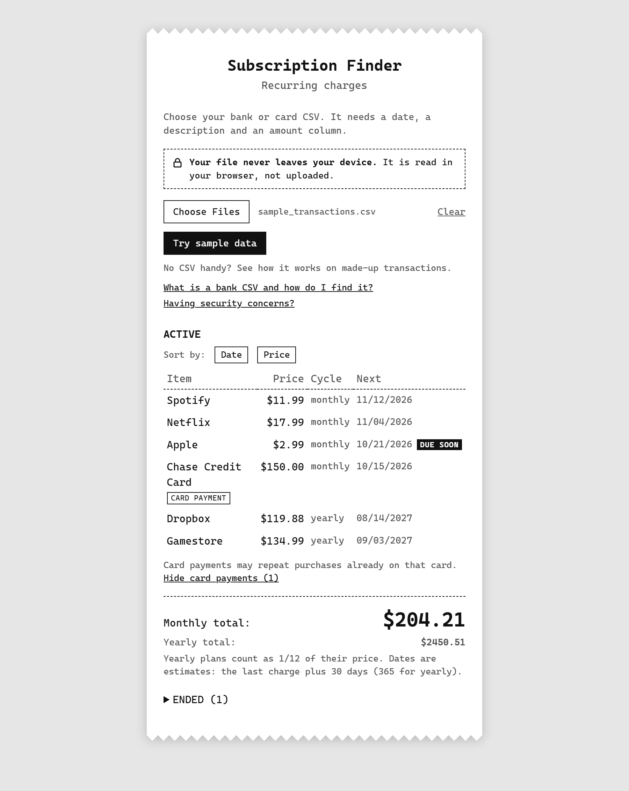

# Subscription Finder

Reads a bank or card statement CSV and lists the charges that repeat: what each subscription costs, when the next one is due, and your monthly and yearly totals. It runs entirely in the browser, so your file is never uploaded.

**Live page:** https://readtheterms.github.io/subscription-finder/ (no CSV handy? Click **Try sample data** to see it on made-up transactions.)

## Features

- **Works with most banks.** It finds the date, description and amount columns from the header row. It also handles a separate Debit column, files with no header row, amounts like `$1,234.50`, and cards that list purchases as positive numbers.
- **Several files at once.** Add as many as you like, even from different banks. If files overlap, a transaction with the same date, description and amount is counted once.
- **Readable names.** `SPOTIFY USA 877-778-1161 NY` becomes `Spotify`, using a list of well-known companies plus some cleanup.
- **See why it was detected.** Hover a row to see how many charges were found, how far apart they were, and when the last one was.
- **Hide a row.** Click a row to gray it out and leave it out of the totals. Click again to count it.
- **Card payments are tagged.** A payment toward a credit card or loan is marked `CARD PAYMENT`, with a note that it may repeat purchases already on that card, and one button to hide or show them all.
- **Sort** by date or price. Click the same button again to reverse.
- **Tags.** `DUE SOON` means the next charge is expected within 7 days. `OVERDUE` means it was expected and didn't arrive. Dates are always estimates, and the page says how they are worked out.
- **Totals.** Yearly plans count as 1/12 of their price in the monthly total. The yearly total is the monthly prices times 12 plus the yearly prices.
- **Account numbers are masked** in the file name shown on screen.

## How it works

Bank descriptions are messy, so each one is cleaned up and turned into a key from its first 15 letters, ignoring case, digits and symbols. Charges with the same key are grouped as one merchant.

A group is a **monthly** subscription if it has at least 3 charges, every gap is 25 to 35 days (55 to 70 for a skipped month, for no more than 20% of the gaps), and at least 80% of the amounts are within 25% of the median. The amount rule is loose on purpose, so a price increase or one-off fee doesn't hide a real subscription.

A group is a **yearly** subscription if it has at least 2 charges, every gap is 350 to 380 days, and every amount is within 25% of the median.

If a merchant's charges don't look like a subscription as a whole, they are split by exact price and each price is checked separately. That finds a yearly charge hidden among a merchant's other purchases.

A subscription is **active** if its last charge is within 40 days (monthly) or 380 days (yearly) of the newest date in the file. Otherwise it is listed under Ended. The next date is the last charge plus 30 days (365 for yearly), so it is an estimate.

Deposits and refunds are ignored. Transfers, Zelle and ATM withdrawals are skipped using a short list of name prefixes, because they move money around and aren't subscriptions. Credit card and loan payments are kept, since they repeat every month too. Hide any you don't want counted.

## Code

| File | What it is |
| --- | --- |
| `docs/index.html`, `docs/style.css` | The page |
| `docs/app.js` | The page's behavior |
| `docs/finder.js` | Reading files and finding subscriptions |
| `docs/companies.js` | Company names (the 2014 Fortune 500) |
| `docs/samples/` | The same made-up transactions in several bank layouts |
| `tests/` | Tests that run on every push with GitHub Actions |

The tests check that the sample and every bank layout give the same subscriptions and totals, plus the detection rules, overlapping files, date and amount reading, and company names. A second set of tests guards the privacy and security settings.

## Limits

- Only monthly and yearly charges are found. Weekly ones are missed.
- If a merchant changes its name on the statement, the old and new names appear as separate entries.
- The 15-letter key can merge different merchants that start the same way, or split one whose name changes early.
- The skip list only covers transfers, Zelle and ATM cash. Credit card payments, rent, insurance and other bills show up as recurring charges, so hide the ones that aren't really subscriptions.
- Overlapping files are only de-duplicated when the same transaction is written the same way in both.
- Dates are read as month/day/year.
- `DUE SOON` uses today's date from your computer, while `OVERDUE` compares against the newest date in the file.
- Layouts for banks other than Chase were written from memory and haven't been checked against real exports.

## Privacy and security

Your file is read in the browser and never sent anywhere, and the page enforces that instead of just promising it:

- A **Content Security Policy** in the page only allows it to contact its own site (to load the sample) and to run its own scripts plus one pinned library. Even a bug or a tampered script could not send your file to another server.
- The Papa Parse CSV library, the only outside code, is loaded from a CDN with a **Subresource Integrity** hash, so the browser refuses it if it ever changes.
- Text from your CSV is written to the page as plain text, never as HTML, and nothing is stored in cookies or browser storage.
- Because anyone can pick any file, there are limits (20 MB, 200,000 rows, 500 characters per cell), and the number-checking pattern is written so a hostile file can't make the page hang.
- Tests fail if any of this is removed.

Real statements are never committed: `.gitignore` blocks every `.csv` except the made-up samples in `docs/`.

## License

MIT. See `LICENSE`.
